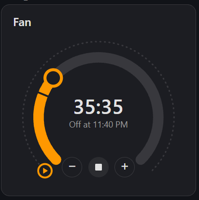
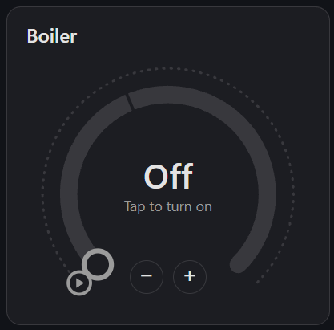
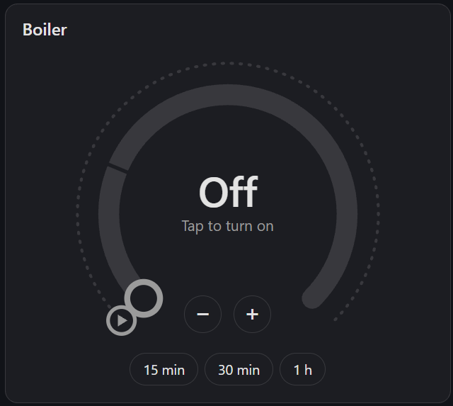

# Dial Timer for Home Assistant

[](https://hacs.xyz)
[](https://github.com/hod25/ha-dial-timer/actions/workflows/validate.yml)


Turn a device on now or later for a set number of minutes, from a circular dial. It turns off on its own when the time is up.
Useful for an electric water heater (boiler), fans, garden lights, irrigation, or anything else you tend to forget to turn off.

It includes a dashboard card that shows a live countdown and a dial for setting the time.

<p>
  
  
  
</p>

Running with `show_controls` · off with `show_controls` · with `show_controls` and `show_presets`. By default the card shows just the dial.

> The integration's domain is `hourly_timer` (its original name), so the `hourly_timer.schedule` action and the `custom:hourly-timer-card` card type keep that name.

## Features

- **No automations needed.** Pick an entity and you get a timer for it.
- **Now or later.** Turn the device on right away, or schedule it to turn on later, for example in an hour for 45 minutes.
- **Survives restarts.** Running and scheduled timers keep going after Home Assistant restarts. If the start or end time passed while Home Assistant was down, the device is turned on or off as soon as it starts again.
- **Follows the device.** If you turn the device off by hand while the timer runs, the timer is cancelled.
- **Works with** `switch`, `light`, `fan`, `climate` and `input_boolean` entities.
- **Card included.** The card is loaded automatically, so you don't need to add a resource.

## Installation

### Home Assistant Marketplace / HACS (recommended)

On Home Assistant 2026.11 and newer, HACS is built in as the **Marketplace** (Settings → Marketplace). On older versions, use HACS.

1. Open the **Marketplace** (or HACS) and search for **Dial Timer**.
2. Download it, then restart Home Assistant.

### Manual

Copy `custom_components/hourly_timer` into your `/config/custom_components/` folder and restart Home Assistant.

## Setup

1. Go to **Settings → Devices & services → Add integration** and choose **Dial Timer**.
2. Pick the entity to control, for example `switch.boiler`.

You get three entities. If the controlled entity belongs to a device, they appear on that device's page.

| Entity | What it does |
| --- | --- |
| `number.<name>_timer_duration` | Set it to a number of minutes (1–1440) to turn the device on now for that long. Setting it again restarts the countdown. `0` turns the device off, or cancels a schedule that hasn't started yet. It goes back to `0` when the timer ends. The `starts_at` and `ends_at` attributes hold the times. |
| `sensor.<name>_timer_starts` | When a scheduled timer will turn the device on, or *unknown* when nothing is scheduled. |
| `sensor.<name>_timer_ends` | When the device will be turned off, or *unknown* when no timer is running or scheduled. |

## Dashboard card

```yaml
type: custom:hourly-timer-card
entity: number.boiler_timer_duration
title: Boiler
```

The card is a circular slider. The ring is a timeline that starts now.

- **On without a timer:** tap the center. The card shows **On · No timer** with a pulsing ring, and tapping again turns it off. It also shows this when the device was turned on some other way, for example from a wall switch. To add a timer, drag the ring.
- **Start now:** drag the ring to choose how long, then let go.
- **Start later:** drag the **▶** handle on the outer ring forward. The start snaps to round clock times (14:00, 14:05…). Drag the ring to change how long it stays on.
- While a timer runs or waits, the center shows a live countdown and a stop button that turns it off or cancels the schedule.

For a smaller card, use `layout: tile`. It fits in one row, like the tile card, and opens the dial when you tap it.

The card is compact by default: just the dial. Turn on `show_controls` for **−/+** buttons and `show_presets` for quick times, from the visual editor or in YAML.

| Option | Default | Description |
| --- | --- | --- |
| `entity` | *required* | The timer's `number` entity. An `input_number` also works, but without the countdown. |
| `title` | none | Card title. |
| `layout` | `dial` | `dial`: the full dial. `tile`: a one-row tile with a small progress ring, the name and a countdown. Tapping the tile opens the dial in a popup, with **−/+** and the quick times (turn them off with `show_controls: false` / `show_presets: false`). |
| `icon` | the device's icon | Icon for the tile. |
| `max_minutes` | `240` | Time at the end of the ring. It can't be higher than the entity's maximum (1440). |
| `dial_step` | `5` | Minutes per step for dragging and for **−/+**. |
| `dial_scale` | `linear` | `linear`: every minute takes the same space on the ring. `progressive`: the first `fine_minutes` go one minute at a time, then `dial_step` at a time, and every step takes the same space. A small notch on the ring shows where the one-minute steps end. |
| `fine_minutes` | `15` | With `dial_scale: progressive`, how many minutes at the start go one minute at a time. |
| `show_controls` | `false` | Show **−/+** buttons under the dial. |
| `show_presets` | `false` | Show quick-time buttons under the dial. It turns on by itself when you set `presets`. |
| `presets` | `[15, 30, 60]` | Minutes for the quick-time buttons. |
| `show_hints` | `false` | Show a help line under the dial. |
| `center_tap` | `toggle` | `toggle`: tapping the center turns the device on or off without a timer. `none`: the center does nothing. Use `none` for devices that must never stay on without a timer, like a water heater. |

To change the ring color, set `--hourly-timer-color` with [card-mod](https://github.com/thomasloven/lovelace-card-mod) or a theme.

## Using it in automations

The number entity is a regular `number`, so you can start a timer from any automation or script:

```yaml
action: number.set_value
target:
  entity_id: number.boiler_timer_duration
data:
  value: 45
```

To start later, use the `hourly_timer.schedule` action with either `start_in` (minutes from now) or `start_at` (a date and time):

```yaml
action: hourly_timer.schedule
target:
  entity_id: number.boiler_timer_duration
data:
  duration: 45
  start_in: 60
```

If a timer is running when you schedule a new one, the device is turned off until the new start time.

## Upgrading from 2.x

Version 2.x tried to create an `input_number.<name>_duration` helper, but that never worked. Version 3 creates its own `number` entity instead.

- Point your cards at the new `number.<name>_timer_duration` entity.
- If you copied `hourly-timer-card.js` to `/config/www` by hand, delete it and remove the `/local/hourly-timer-card.js` dashboard resource. The integration now loads the card itself.

## Development

Run the tests with Docker:

```bash
docker run --rm -v "$PWD:/repo" -w /repo python:3.14-slim \
  sh -c "pip install -q -r requirements_test.txt && pytest"
```

## License

MIT. See [LICENSE](LICENSE).
